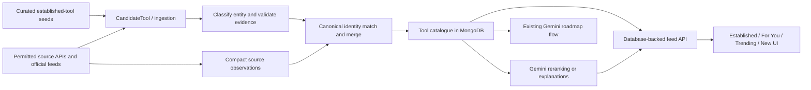

# ToolThread: Backend Data Discovery & Recommendation Architecture Audit

**Status:** Proposed implementation plan; based on a read-only source audit.  
**Scope:** No project code changes are included in this report.

## 1. Executive summary

ToolThread already has the beginnings of a catalogue pipeline: collectors write candidates to MongoDB, validation promotes them into a `Tool` collection, and the feed API queries that catalogue. It also has cached Gemini recommendations and roadmaps. Those components can be extended rather than replaced.

The main relevance issue is not just which external sources are queried. It is that the platform does not yet have a working, connected catalogue of established tools and does not consistently distinguish products from packages, repositories, and news stories.

**Verified causes:**

- The active collectors are narrow: Hacker News stories and npm packages. The GitHub collector is commented out, and the “Awesome AI” collector is a no-op.
- The active sources favor recent mentions and AI-related packages; they do not supply a curated baseline of established design products.
- Validation checks for a name and URL, then deduplicates by exact name. It does not verify that the URL is the product’s official website or that the candidate is a useful product.
- Candidate source details and most measured engagement data are discarded when candidates become `Tool` records.
- “Trending” is inferred from an absolute Hacker News score threshold; GitHub results would all be marked trending if that collector were enabled. Neither method measures growth.
- The MongoDB feed and Gemini recommendations are separate paths. The dashboard’s “Live Trends” data is currently mock data, not the collector output.
- A role-specific hardcoded list includes Figma and other examples, but it is not connected to the database or recommendation flow.

**Recommended first release:** connect a small, reviewed seed catalogue of established tools to MongoDB; add deterministic role/use-case metadata and ranking; preserve the existing database-backed feed API; and clearly distinguish established, personalized, trending, and new-launch results. Add source-aware trend signals afterward, only where the source provides measurable evidence and permitted access.

## 2. Existing architecture and verified findings

### Discovery and persistence

The pipeline described by `node testCollectors.js` is present: it connects to MongoDB, runs collectors, validation, website resolution, and enrichment ([backend/testCollectors.js](./backend/testCollectors.js)). It was not run during this audit because it writes to the database and invokes external services.

`runCollectors()` currently runs the Hacker News and npm collectors. GitHub is commented out; the Awesome AI collector is a no-op and is not called ([backend/collectors/runCollectors.js](./backend/collectors/runCollectors.js), [backend/collectors/awesomeAiCollector.js](./backend/collectors/awesomeAiCollector.js)).

- The Hacker News collector requests the top 50 stories, applies title/URL keyword heuristics, and writes matching candidates. It sets `isTrending` when an individual story’s score exceeds 100; the story’s `time` is not retained as a publication timestamp ([backend/collectors/hackerNewsCollector.js](./backend/collectors/hackerNewsCollector.js)).
- The npm collector searches four AI-related terms, filters package metadata for AI-related words, and records `weeklyDownloads` and the npm search relevance score in candidate metadata ([backend/collectors/npmCollector.js](./backend/collectors/npmCollector.js)). These results are packages, not necessarily end-user products.
- The GitHub collector searches for “AI tool” repositories with more than 500 stars and marks every result as trending. It is currently disabled by `runCollectors()` ([backend/collectors/githubSearchCollector.js](./backend/collectors/githubSearchCollector.js)).
- The README mentions Reddit and PyPI as discovery sources, but no corresponding collector is present in the backend file list. The existing Reddit collector test imports a missing `redditCollector` module ([backend/tests/redditCollector.test.js](./backend/tests/redditCollector.test.js)).

Candidates are stored in `CandidateTool`. Validation rejects records missing a name or URL, checks duplicates using exact `Tool.name`, and otherwise creates a `Tool` record ([backend/validators/validateCandidate.js](./backend/validators/validateCandidate.js)). It copies selected fields but does not copy the candidate’s `sources` array, `lastDiscoveredAt`, `discoveryScore`, `mentionCount`, or most source-specific metadata. `Tool.source` is a single string, so the final record cannot retain the full provenance already modeled on candidates.

The website resolver does not actually resolve or verify a URL: when a URL exists, it marks the record resolved ([backend/resolvers/officialWebsiteResolver.js](./backend/resolvers/officialWebsiteResolver.js)). Enrichment fetches the supplied URL and uses page metadata, but does not establish that the URL belongs to the product ([backend/enrichers/websiteEnricher.js](./backend/enrichers/websiteEnricher.js)). For npm candidates, the stored URL can be a package page or repository rather than the product homepage.

### Catalogue, feed, and recommendations

The `Tool` schema already supports descriptions, categories, tags, platforms, URLs, GitHub counts, a `score`, and feed indexes ([backend/models/Tool.js](./backend/models/Tool.js)). Its unique name constraint and the validator’s exact-name match do not provide robust canonical identity across product-name variants, package names, repository names, or multiple source URLs.

`GET /api/feed` calls `getFeed()` and reads validated records from MongoDB ([backend/routes/feed.js](./backend/routes/feed.js), [backend/services/feedService.js](./backend/services/feedService.js)). It supports `new`, `popular`, `trending`, `for_you`, and `recommendations`.

- `popular` sorts by GitHub stars, so candidates without GitHub data have little or no useful ranking signal.
- `trending` sorts by `isTrending`, `score`, and stars. Candidate `discoveryScore` and story engagement are not transferred to `Tool.score`.
- `for_you` matches role keywords, then blends relevance, GitHub stars, the trending flag, score, and record age. It loads every matching `Tool` into memory before ranking. Interest, skills, and experience level are not used by this feed scorer.
- “New” is based on the MongoDB record’s `createdAt`, not a verified product launch or announcement date.

The API also has `GET /api/tools`, which returns all records sorted by name without pagination ([backend/routes/tools.js](./backend/routes/tools.js)). The primary frontend currently uses `/api/feed` instead.

Gemini recommendations are separate from the catalogue feed. `/api/recommendations` uses `recommendationResolver` to return a cached or newly generated list of 12 tools. Gemini is prompted to supply names and official URLs; the generated results are not required to correspond to `Tool` records ([backend/routes/recommendations.js](./backend/routes/recommendations.js), [backend/services/recommendationResolver.js](./backend/services/recommendationResolver.js), [backend/services/aiRecommendation.js](./backend/services/aiRecommendation.js)). Roadmaps are also Gemini-generated and cached separately; there is no concrete reason to replace that feature.

The frontend makes the separation visible:

- The dashboard calls `api.getTools()`, which requests the **popular MongoDB feed**, and `api.getLiveTrends()`, which returns mock data ([frontend/src/hooks/useDashboardData.ts](./frontend/src/hooks/useDashboardData.ts), [frontend/src/services/api.ts](./frontend/src/services/api.ts)).
- `/discover` requests the popular feed but labels it “Recommended Tools For You” ([frontend/src/routes/discover.tsx](./frontend/src/routes/discover.tsx)).
- `/ai-tools` calls `/api/recommendations`, the Gemini path ([frontend/src/routes/ai-tools.tsx](./frontend/src/routes/ai-tools.tsx)).
- `api.getTrendingTools(role)` calls the role-based `for_you` feed, but it is not used by the current dashboard path.
- A hardcoded role-based data file includes entries such as Figma and Framer, but no backend code imports it ([backend/data/tools.js](./backend/data/tools.js)).

### Scheduling, caching, and tests

No scheduled collector job was found. `testCollectors.js` is a manual pipeline runner, not a scheduler. Recommendation and roadmap results are cached in MongoDB; the feed itself has no application-level cache.

The backend package’s `test` script intentionally exits with “no test specified,” and the existing Reddit test refers to a missing collector ([backend/package.json](./backend/package.json), [backend/tests/redditCollector.test.js](./backend/tests/redditCollector.test.js)). Unit tests for canonicalization, validation, ranking, and source metrics should be added before expanding the pipeline.

## 3. Root causes of poor recommendations

### Confirmed

1. **No active established-tool source.** The unused hardcoded role lists do not seed `Tool`, so established products are not guaranteed to exist in the database.
2. **Discovery is source-led rather than role-led.** Hacker News and npm searches find items that match broad terms, not items selected for a user’s role or goals.
3. **Candidate types are conflated.** The current pipeline can promote a news submission, npm package, or repository into the same `Tool` collection. Categories such as “HackerNews Submission” describe a source entity, not a user-facing product category.
4. **URLs are treated as verified without verification.** Existing URLs are marked resolved; a valid URL is not evidence that it is official.
5. **Trend flags lack growth evidence.** Hacker News uses an absolute score threshold, and the disabled GitHub collector would mark all results trending. Neither establishes that interest is growing.
6. **Evidence is lost during promotion.** The candidate provenance and source metrics are not retained in canonical `Tool` records. The npm search score is a search relevance score, not a time-series trend measure.
7. **Frontend labels do not match the data.** The “For You” dashboard section is backed by popular sorting, Discover is also backed by popular sorting, and the Live Trends section is mock data.
8. **The personalized feed is not the primary dashboard route.** The role-based feed exists, but the dashboard’s `getTools()` path does not call it.

### Likely, but requiring database evidence to quantify

- Existing records may include duplicates with different names or URLs, and may contain non-product stories or package records. The current code makes these outcomes possible, but I did not inspect production data.
- Some previously stored records may have stale or incorrect “official” URLs. The resolver and enrichment flow do not verify ownership, but the actual number of affected records is unknown.
- Candidate upserts can overwrite a prior source list with the current source’s list rather than aggregate provenance. The collector updates provide this risk; the extent of existing data loss requires a database inspection.

## 4. Recommended architecture and data flow

Keep the existing Express/Mongoose application and collections. Use `CandidateTool` as the discovery/review queue and `Tool` as the canonical user-facing catalogue.

Recommended behavior:

- **Established tools:** seed a deliberately small, reviewed set with official websites, clear categories, and role/use-case tags. Do not require a recent mention or launch.
- **Incremental discovery:** collect only limited, permitted source results. Treat HN posts as evidence about a product, not as products by default. Treat npm packages and GitHub repositories as distinct entity types.
- **Validation and identity:** use stable source IDs where available, then normalized canonical URLs and aliases. Do not equate a repository’s URL with a product homepage. Merge repeated discoveries into one canonical tool and retain source attribution.
- **Official URL verification:** store verification status and timestamp. Prefer URLs supplied by the product itself or a trusted official record; do not mark every non-empty URL as verified.
- **Trend signals:** record compact, dated metric observations for a canonical tool (for example, GitHub stars or HN score/comments at collection time). Compute change between observations; do not infer growth from one absolute count.
- **Feed ranking:** query the database and expose separate views or labels for established, personalized, trending, and newly announced items. Gemini may classify or explain catalogue items, but should not be the source of factual identities, URLs, or popularity claims.
- **Storage restraint:** retain canonical tool records, source IDs/URLs, timestamps, and small metric snapshots only. Do not persist whole articles, full external pages, complete repository histories, or entire external directories. Expire stale snapshots and rejected candidates according to a configurable retention policy.

A separate trend-signal collection is not required for the initial release. A small, capped observation array on `Tool` is simpler at this scale; introduce a separate TTL-managed collection only if retention, query volume, or signal volume later makes embedded observations unsuitable.

## 5. Data source strategy

Access terms and API availability below are based on public official documentation reviewed for this audit. Check the source’s current terms before launch, especially before storing or displaying third-party content.

| Source | Contribution and intended use | Access, limits, and restrictions | First release |
|---|---|---|---|
| **Curated product seeds / official product sites** | Established tools, correct canonical URLs, descriptions, categories, role/use-case tags. Official announcements can add launch dates or release evidence. | No universal API: verify each product’s own site and permitted feeds individually. Store concise metadata and link back; do not copy full pages. | **Essential.** Seed the initial catalogue manually and review it. |
| **GitHub REST API** | Open-source repositories, repository identity, stars/forks, and dated observations. Useful for developer tools and OSS projects, not a substitute for a product catalogue. | Official [repository search docs](https://docs.github.com/en/rest/search/search) state authenticated search allows 30 requests/minute (code search has separate limits); unauthenticated search allows 10/minute. The general [REST rate-limit docs](https://docs.github.com/en/rest/using-the-rest-api/rate-limits-for-the-rest-api) list 60 requests/hour unauthenticated and 5,000/hour for standard authenticated requests, with secondary limits. Use the API and handle rate-limit headers; avoid scraping. | **Useful, not necessary for established design coverage.** Re-enable only after entity classification and trend tracking are fixed. |
| **Hacker News API** | Discussion evidence, story timestamps, scores, and comment counts. Useful as a discovery and discussion signal, not as a trusted product directory. | The official [Firebase API documentation](https://github.com/HackerNews/API) documents public item/story endpoints and currently says there is no rate limit. It also notes the API may change; use conservative requests and retain links/IDs rather than republishing post content. | **Keep, but reposition.** Use stories as evidence attached to a tool when identified; do not promote every qualifying story. |
| **npm registry** | Package identity, description, repository/homepage fields, and package-specific usage signals. Useful for developer libraries, not visual-design products generally. | The official [registry API docs](https://github.com/npm/registry/blob/main/docs/REGISTRY-API.md) describe search and package metadata endpoints; npm’s [registry documentation](https://docs.npmjs.com/cli/v11/using-npm/registry) says use is subject to [npm terms](https://docs.npmjs.com/policies/terms). The collector’s weekly downloads and search score are not growth measurements without stored baselines. No numeric quota is asserted here; handle throttling and check current terms. | **Keep selectively** for package entities. Do not let packages dominate a general product feed. |
| **Product Hunt** | Launch dates, launch ranking, and product metadata. Potential source of newly launched products. | The official [API v2 docs](https://api.producthunt.com/v2/docs) describe GraphQL access requiring an access token and fair-use throttling. The docs explicitly say the API must not be used commercially without contacting Product Hunt. | **Defer.** ToolThread’s commercial status/permission is unresolved; obtain written approval before building on it. |
| **Dribbble** | Design inspiration and community work; useful for inspiration, not for discovering established software tools. | The official [API docs](https://developer.dribbble.com/v2/) require a registered application and OAuth; they document 60 requests/minute and 1,440/day per authenticated user. The [API terms](https://developer.dribbble.com/terms/) say use only API-exposed data, prohibit scraping and storing Dribbble data, and require compliance with member rights. They also ask applications to contact Dribbble if use is uncertain. | **Defer.** Do not persist its content. Consider only after confirming the intended product use is permitted. |
| **Behance** | Design portfolios and project inspiration, rather than a tool catalogue. | A current official API access path, licensing terms, and permitted storage were not verified during this audit; the previously discoverable developer URL returned 404. Do not infer that public pages may be scraped. Confirm access and terms with Adobe before use. | **Defer.** |
| **Awwwards** | Curated web-design inspiration and featured websites, not a product directory. | The official [terms](https://www.awwwards.com/terms/) state site material is Awwwards property and unauthorized use or reproduction is prohibited. No official public API/feed suitable for this integration was verified. | **Defer.** Do not scrape or republish site content without permission. |
| **Framer public showcases** | Potential examples of websites and design trends; not an established-tool source. | An official API or permitted feed for showcase ingestion was not verified in this audit. Treat showcase pages as human-browsed references only until documented access and terms are confirmed. | **Defer.** |

Official product RSS feeds and changelogs can be useful for release announcements, but availability and terms are product-specific. Use only feeds that are documented or explicitly published for reuse, retain the canonical link and publication date, and avoid storing full article text. They are optional for an initial release.

## 6. Database and API changes

### Minimal schema evolution

Extend the existing models; do not add a second catalogue collection.

- **`Tool`:** retain existing descriptions, category, tags, platforms, URLs, and indexes. Add a canonical identity key (introduced only after existing duplicate analysis), aliases, entity kind (for example product, package, repository), and role/use-case tags. Add official-URL verification status/timestamp and source provenance. Retain existing GitHub fields but do not treat raw star totals as trend growth.
- **Source provenance:** carry forward a compact form of `CandidateTool.sources` into the canonical `Tool`, including source type, source URL, external ID, discovery timestamp, and permitted measured metadata.
- **Trend observations:** store dated, bounded metric snapshots, such as GitHub stars or HN score/comments. Keep the array small and prune old observations. Treat missing history as “trend unknown,” not “trending.”
- **`CandidateTool`:** retain the discovery queue, but make entity type and validation status explicit. Upserts should merge source evidence rather than replace earlier sources. `mentionCount` should be derived from distinct source observations or removed; it must not imply independent mentions when repeated polls observe the same item.
- **Migration:** first report normalized-identity collisions and map existing records; do not auto-delete or blindly merge. Backfill source provenance where candidate records still exist. Add a unique canonical-key index only after collisions are reviewed. Preserve the current name uniqueness constraint until migration and callers are tested.

Permanent data should be the curated canonical tool record and compact source attribution. Trend snapshots can be retained for a bounded, configurable period (for example 60–90 days); raw articles, full pages, and large source payloads should not be stored. Candidate/rejection retention should be separately configurable so that pending records are not accidentally expired.

### API and frontend changes

- Extend `GET /api/feed` and `getFeed()` with explicit catalogue views such as established, personalized, trending, and new launches. Keep existing `popular`, `new`, and other values as compatibility aliases during rollout. A new-launch view must use a source publication/launch date, not MongoDB insertion time.
- Keep ranking database-backed and cursor-paginated. Avoid loading the entire catalogue into memory for `for_you`; filter and rank a bounded set or use indexed database queries as catalogue size grows.
- Use stored role, interest, and experience level when available. The current user schema holds role/interest/level, but not skills or career goals; add those only if onboarding and product requirements call for them.
- Keep `/api/recommendations` working during migration. Change its recommendation source in a later phase so Gemini selects or explains known catalogue records rather than inventing unverified names and URLs. Preserve the existing roadmap endpoint and cache.
- Update `frontend/src/services/api.ts` so its method names match their feed types. Update Discover’s heading and data request so it does not label a popularity list as personalized recommendations.
- Replace mock Live Trends content only when the backend can supply attributable, timestamped observations. Until then, label it as sample content or remove the “live”/“AI-summarized from live sources” claim.
- Keep `/api/tools` for compatibility, but consider pagination or deprecation if it becomes a public catalogue endpoint; it currently returns all records.

## 7. Phased implementation plan

### Phase 1 — Establish a useful, testable catalogue

- **Objective:** guarantee that core role-relevant established tools are present without requiring recent mentions.
- **Files:** extend `backend/data/tools.js`; update `backend/models/Tool.js`; add an idempotent `backend/scripts/seedTools.js`; add focused tests under `backend/tests/`.
- **Reuse:** current role-oriented seed lists, `Tool` model, and `/api/feed`.
- **Migration:** seed/upsert by a reviewed canonical identity; do not delete current records.
- **Tests and acceptance:** repeated seed runs create no duplicates; known seed records have verified official URLs and categories; one UI/UX profile returns core design tools in its first page.
- **Risk/rollback:** keep additions additive and record seed provenance so a bad seed can be corrected without clearing the catalogue.

### Phase 2 — Align feed ranking and UI labels

- **Objective:** make established, personalized, trending, and newly launched results distinct and truthful.
- **Files:** `backend/services/feedService.js`, `backend/routes/feed.js`, `frontend/src/services/api.ts`, `frontend/src/routes/discover.tsx`, `frontend/src/hooks/useDashboardData.ts`, and the relevant dashboard components.
- **Reuse:** existing cursor pagination, role keyword matching, frontend `AiTool` shape, and existing route.
- **Migration:** none required if new fields are optional and existing feed types remain supported.
- **Tests and acceptance:** feed type and cursor behavior; role relevance; stable pagination; absent growth evidence never yields a trending badge; no regression in existing route responses.
- **Risk/rollback:** retain existing feed types as aliases and switch frontend views behind a small, reversible change.

### Phase 3 — Preserve identity and source evidence through ingestion

- **Objective:** distinguish products, packages, repositories, and news; deduplicate robustly; preserve evidence.
- **Files:** `backend/models/CandidateTool.js`, `backend/models/Tool.js`, `backend/collectors/hackerNewsCollector.js`, `backend/collectors/npmCollector.js`, `backend/collectors/githubSearchCollector.js`, `backend/collectors/runCollectors.js`, `backend/validators/validateCandidate.js`, `backend/resolvers/officialWebsiteResolver.js`, and `backend/enrichers/websiteEnricher.js`.
- **Reuse:** existing collectors, candidate queue, and resolver/enricher modules.
- **Migration:** generate a duplicate report before canonical-key uniqueness; backfill provenance when possible; do not promote HN articles as products by default.
- **Tests and acceptance:** repeated source items merge; unrelated entities do not merge by a vague name match; source IDs and timestamps survive promotion; non-official URLs are not presented as verified; collectors report partial failures explicitly.
- **Risk/rollback:** keep old source fields readable and introduce new identity fields alongside them until data cleanup is validated.

### Phase 4 — Add measured trend evidence and permitted sources

- **Objective:** show a trend label only when observed source evidence supports growth.
- **Files:** extend `backend/models/Tool.js` (or add a bounded signal model later), update the relevant collectors and `feedService.js`, and connect the frontend trends components.
- **Reuse:** GitHub/HN/npm clients already in dependencies and current source metadata.
- **Migration:** old `isTrending` values lack historical evidence. Do not backfill them as measured growth; treat them as unknown until new observations exist.
- **Tests and acceptance:** metric deltas computed only from dated observations; duplicate polling does not count as multiple sources; missing history does not display “trending”; timestamps and source attribution are shown.
- **Risk/rollback:** keep trend scoring configurable and disable trend labels if a source stops supplying reliable measurements. Do not add Product Hunt, Dribbble, Behance, Awwwards, or Framer scraping without verified access and permission.

### Milestone 4 evidence foundation (2026-10-26)

- Added `backend/models/TrendObservation.js` for dated, numeric observations linked to a catalogue tool, with source, signal type, source-event identity, and deterministic duplicate identity.
- Added `backend/services/trendService.js`: comparisons are restricted to one tool/source/signal/event; at least three unique timestamps over 24 hours are required within a seven-day lookback; the newest must be no older than 48 hours; the first measurement must be positive; growth of at least 10% is increasing, a change between -10% and +10% is stable, and a decline of at least 10% is decreasing. Invalid, conflicting, stale, or insufficient data is not trending.
- Added `backend/scripts/recordTrendObservations.js`. It validates JSON input and catalogue tool references, runs read-only by default, and only writes with the explicit `--write` option. Supported manual signals are GitHub total stars and npm weekly downloads; imports must include the actual source measurement time and event identity.
- Manual workflow: save an array of `{ "toolId": "<catalogue ObjectId>", "source": "github", "signalType": "stars_total", "measurement": 1234, "observedAt": "<source observation ISO timestamp>", "sourceEventId": "<verified owner/repository>" }` records as JSON, then run `node scripts/recordTrendObservations.js <input.json>` from `backend` to validate without writing; add `--write` only after reviewing the dry run to persist observations. For npm use `source: "npm"`, `signalType: "weekly_downloads"`, and the exact package name as `sourceEventId`. Re-imports at the same event/time are idempotent, and conflicting measurements are rejected.
- The checked-in collector pipeline does not currently provide trustworthy, persisted tool-level time series: GitHub collection is disabled in `runCollectors.js`; active HN data is story-level and not reliably linked to catalogue tools; npm weekly downloads are transient candidate metadata and are not copied into catalogue records as dated samples. No source currently supplies sufficient history by itself.
- The `type=trending` feed now aggregates observations in MongoDB over the seven-day window, groups by tool/source/signal/event and timestamp to detect conflicting duplicate measurements, and applies the shared trend-summary classifier. It returns only increasing measurements attached to validated catalogue tools, with source/signal, event identity, growth percentage, and measured interval in `trendEvidence`. Results are ordered by tool ObjectId and cursor-paginated deterministically; tools with multiple qualifying sources use the first source/signal/event in lexical order, without ranking incomparable source metrics against each other. Stable, decreasing, stale, conflicting, malformed, or insufficient groups are excluded. No observation results still returns the existing empty `{ tools, pagination }` response.
- A compound `{ observedAt, toolId, source, signalType, sourceEventId }` index is defined for the bounded aggregation query. Automatic index creation remains disabled; deployment must provision the index through its existing database operations rather than this feature running a migration.
- Do not infer trends from `isTrending`, lifetime stars, HN story dates, or established-catalogue status. A manually verified tool/source identity and repeated dated measurements are required before a trend can appear.
- Manual observation imports require source timestamps, measurement values, and event identifiers as user-supplied fields; the importer validates their shape and catalogue tool reference but does not verify them against GitHub/npm source records. Authenticity and event identity remain operator assertions until source-backed collector integration exists.
- The obsolete `backend/tests/redditCollector.test.js` was removed during Milestone 4 remediation. Git history shows the Reddit collector was added experimentally in `489c42d` but deliberately removed as unused in `5aa3d3c`; it is absent from the active runner and the surviving test only exercised a synthetic fallback. No Reddit collector or external integration is part of this milestone.
- No migration, collector run, scheduler, external integration, or database write was performed for this milestone.

## 8. Testing and success criteria

Use fixtures and stubbed source responses for unit tests. Avoid live API tests in the normal suite. For optional Mongo integration tests, use a disposable test database and never run the collector pipeline against production data.

| Profile | Established-tool relevance | Freshness and trend evidence | Duplicates and URLs |
|---|---|---|---|
| **UI/UX and graphic designer** | Seed and rank Figma, Photoshop, Illustrator, and Framer as relevant established tools; new design tools may appear separately. | Established tools remain visible without recent mentions. A new launch is dated; a trending label requires observed growth evidence, not age or one story score. | Same product discovered from a website, repository, and discussion resolves to one canonical record; official product URLs are verified. |
| **AI/ML developer** | Include foundational development/model tools as curated records; distinguish packages and repositories from products. | GitHub star totals alone do not prove growth. Test dated snapshots and source attribution; unknown history produces no trending badge. | Same project found from npm, GitHub, and HN is not duplicated; a package and its vendor product are linked or separately typed appropriately. |
| **Data analyst** | Seed role-relevant analytics and data tools independently of the active AI collector’s search results. | Recent analytics mentions are not automatically launches or trends; require valid dates and measurable signals. | Distinct tools with similar names remain separate; official URLs are checked and source links remain attributable. |

**Initial release acceptance criteria:**

1. Seed loading is repeatable and does not create duplicate canonical records.
2. Each profile’s first page includes its curated essentials; established results do not disappear because they lack recent activity.
3. “For You” uses the user’s profile instead of silently returning popular results.
4. Trending labels require dated growth observations or an explicitly configured, defensible source threshold; missing data is “unknown.”
5. New-launch labels require a source-backed launch/publication date.
6. Duplicate discoveries preserve source links and do not create duplicate feed cards.
7. Feed pagination and legacy endpoint behavior are covered by tests.
8. No tests depend on a real Gemini key, external service, or write-capable production database.

## 9. Risks, limitations, and estimated effort

- **Catalog quality requires editorial ownership.** A small maintained seed list is more useful than a large unreviewed crawl, but someone must review additions and official URLs.
- **Source metrics are not directly comparable.** GitHub stars, npm downloads, and HN points have different meanings. Normalize within source/category and display source context instead of presenting a universal popularity score.
- **Historical trend data does not exist yet.** Existing flags and totals cannot reliably reconstruct growth. A trend feature needs scheduled observations before it can make defensible claims.
- **Third-party terms can constrain storage and display.** Dribbble explicitly prohibits storing its data; Product Hunt’s API documentation excludes commercial use without permission. Other source permissions need verification before integration.
- **Existing data may need manual deduplication.** A unique name constraint is not a canonical identity system. A migration should report collisions for review before adding a unique key.
- **No production database review was performed.** The number of stale, duplicate, or misclassified records is unknown.
- **Scheduling remains an operational decision.** There is no existing scheduler. A low-frequency scheduled job can be added later using the current backend deployment environment; a message broker or microservice is not justified by the code or stated scale.

**Effort estimate for a solo developer familiar with the codebase:**

- First useful curated-catalogue and role-feed milestone: **3–5 developer days**.
- Provenance, identity matching, source classification, and migration work: **3–5 days**.
- Frontend view alignment, trend evidence collection, and focused tests: **2–4 days**.

A complete essential first release is roughly **8–14 developer days**, assuming access to a non-production MongoDB database and no blocking source-permission requirements. Optional integrations with launch/design platforms, a review interface, and richer scheduled trend monitoring should be estimated after access and terms are confirmed.

## 10. What to implement first

Start with the curated baseline and profile-aware feed, not more collectors. The current code already has MongoDB feed endpoints and role scoring; the smallest useful change is to make the existing role lists real canonical catalogue records, ensure the dashboard requests the personalized feed, and test that established tools rank correctly. Keep trend labels conservative until time-series measurements exist.

### Prioritized first-version checklist

- [ ] Expand the existing role-based seeds in `backend/data/tools.js` into reviewed catalogue records with canonical official URLs, categories, entity type, and role/use-case tags.
- [ ] Add a repeatable seed script at `backend/scripts/seedTools.js`; upsert only reviewed records and never clear the database.
- [ ] Extend `backend/models/Tool.js` minimally for canonical identity, role/use-case metadata, and URL verification state; defer destructive deduplication.
- [x] Update `backend/services/feedService.js` so established and personalized views use the catalogue and missing trend evidence does not imply trending.
- [ ] Update `frontend/src/services/api.ts`, `frontend/src/hooks/useDashboardData.ts`, and `frontend/src/routes/discover.tsx` so labels match the requested feed.
- [ ] Add tests for repeatable seeding, UI/UX/AI-ML/data-analyst ranking, canonical duplicate handling, pagination, and trend evidence requirements; replace the nonfunctional backend test script.
- [ ] Keep `backend/services/aiRecommendation.js` and the roadmap flow intact for this first milestone; later constrain Gemini recommendations to canonical catalogue records.
- [ ] Leave Product Hunt and design-platform ingestion out of the first release until their current access and usage permissions are verified.
